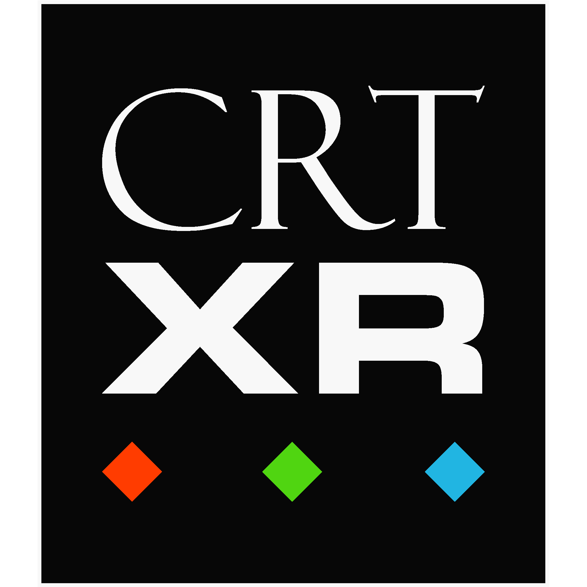
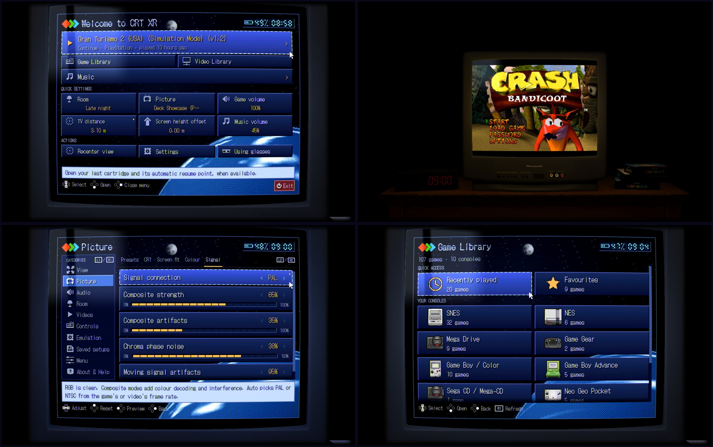

  

<h1 align="center">CRT XR</h1>

  The ultimate millennial nostalgia experience for your XR glasses 
  Retro games, your own videos and music visualisers, head tracking, warm lighting and the radio on in the background.

  <a href="#get-started">Get started</a> ·
  <a href="#features">Features</a> ·
  <a href="https://github.com/blackalice/CRT-XR/releases">Downloads</a> ·
  <a href="docs/glasses/README.md">Glasses guides</a> ·
  <a href="docs/USING-CRT-XR.md">Using CRT XR</a> ·
  <a href="THIRD_PARTY.md">Credits</a>

> [!NOTE]
> CRT XR is an **early public beta**. VITURE Pro 2 is tested on Steam Deck and Windows; other glasses are expected to work and reports are welcome. See [known limitations](docs/PRE-LAUNCH-CHECKLIST.md).

*Bring your own games; no games are included.*

## Get started

Download **one** package from [GitHub Releases](https://github.com/blackalice/CRT-XR/releases):

| You have | Download | Then |
|---|---|---|
| **Steam Deck** | `CRT-XR-<version>-SteamDeck.tar.gz` | In Desktop Mode, extract it and double-click **Install CRT XR**. It adds CRT XR to Steam and can take you back to Gaming Mode. |
| **Windows PC** | `CRT-XR-<version>-Windows.zip` | Extract it and double-click **CRT-XR.exe**. Nothing to install. If Windows warns, choose **More info → Run anyway** (the app is unsigned). |

Then, in CRT XR:

1. **First-run setup** (four short steps) teaches the menu shortcut, sets up your view and finds your ROM folder. EmuDeck, RetroDECK and plain `roms` folders are found automatically.
2. **Playing with glasses?** Follow the guide for your setup: [Steam Deck](docs/glasses/STEAM-DECK.md) · [Windows with VITURE](docs/glasses/WINDOWS-VITURE.md) · [Windows with XREAL, Rokid, RayNeo and others](docs/glasses/WINDOWS-OPENTRACK.md).
3. **No glasses?** Choose **This screen**: the game fills your screen with the CRT picture.

**L1 + R1 + Start** (LB + RB + Start, or Escape) opens the menu; **R3** recentres. The `…-source-code.tar.gz` download is for rebuilding and licence compliance, not an app.

## Features

- **A CRT in your space.** A detailed television, wooden table and baked contact shadows, with a dim red clock radio showing the real time, a VCR on a shelf and a stack of game boxes. Switch props off individually and choose 90s confetti carpet (the default), wool carpet or wooden floorboards. Light the room by the TV alone, add rain on the window or a ticking clock, and see the playing game's cover on the table. The surroundings fade into black to suit XR glasses.
- **Stereo and head tracking.** Full side-by-side rendering and rotational **3DoF** tracking let you look around an anchored screen. Adjust its distance, height, size and curvature, then recenter with a stick click.
- **A picture you can tune and keep.** Scanlines, phosphor detail, glass reflections, PAL/NTSC-inspired signal effects and colour controls. Save your own **looks** and give them to a game, a whole console or a hand-picked set of games: edit a look once and they all change. Share looks as short codes. Screen-fitting options keep the full game image inside the tube.
- **Fifteen classic systems.** SNES, NES, Mega Drive / Genesis, Master System, Game Gear, Game Boy / Game Boy Color, Game Boy Advance, PC Engine / TurboGrafx-16, Sega CD / Mega-CD, PlayStation, Nintendo 64, Atari 2600, Atari Lynx, Neo Geo Pocket / Color and Vectrex, powered by libretro cores. PlayStation games can stay zipped: they unpack in the background behind a spinning-disc loading screen on the TV. The Nintendo 64 draws with the GPU at its own 320×240, so it gets the same CRT picture.
- **Your videos on the tube.** Choose a video folder and your MP4, M4V and MKV files play on the CRT with the same picture, light and sound as games: letterbox, 14:9 or fill for widescreen, subtitles, resume and Continue watching. The VCR joins in with green on-screen text, an optional VHS or worn-tape look and its mechanism sounds. The Steam Deck uses SteamOS's own FFmpeg; Windows downloads FFmpeg's video libraries once, on request.
- **A library that understands your folders.** Pick your ROM root or SD card and browse supported systems, Recent and Favourites. Unrelated console folders stay out of the way. If you've scraped box art with EmuDeck, ES-DE or RetroDECK, CRT XR shows it from your existing `downloaded_media` (or `media` folders beside your ROMs). For anything missing, you can choose to download covers from libretro-thumbnails.
- **Your music, in the room.** Play MP3 albums or direct MP3 web radio with positional sound and optional room reverb. Use the pause-menu transport and seek bar, and optionally lower game audio while music plays. The last track and position are restored, ready for you to press Play.
- **Music visuals on the tube.** A projectM-powered visualiser responds to your albums or radio on the CRT, with three bundled presets (or your own), adjustable brightness and optional automatic preset changes. Return to the menu without stopping the music or visuals, then restore your previous game or video when you're done.
- **Responsive play.** Optional input preview in a separate copy of the emulator reduces input delay while keeping game audio intact. **Reset game** in the pause menu emulates the console's reset button and keeps battery saves and save states.
- **Your controls, your way.** Put any console button on any control: pick a layout, then press the button you want. Each console keeps its layout and any game can have its own, with presets such as Smash Bros. and twin-stick shooting for the N64. Buttons are drawn the same way throughout the menus, by position, so they read right on any pad.
- **A 90s console-style menu.** Pixel lettering, a moving planet and stars, and an animated three-diamond boot logo with startup sound and optional menu music. Menus appear on the CRT with your current picture settings by default; choose a clean menu feed for readability or float the menu in front of the TV. Games and videos share library shortcuts, quick settings and screenshot/recenter actions.
- **Controller-first adjustments.** Quick settings put room and picture presets, TV distance, screen height and volume within reach, with compact placement previews. Organised settings pages, controller text entry, per-option resets, scenes and per-game picture preferences keep adjustments simple. **Games → Console settings** offers console defaults and per-game overrides, applied when the game next loads. Settings start simple, with fine-tuning one press away. Accessibility options include larger text, stronger contrast and reduced animation. Four save-state slots per game with pictures, automatic resume points and clean screenshots are built in. The menu header shows the time, and the Deck's battery.
- **Always something on.** Saturday Morning TV turns your video folder into a channel with its own daily running order, so you tune in mid-programme. Rewind and fast-forward for 8- and 16-bit games, Surprise me for a random pick, optional box art downloads, a sleep timer and your own visualiser presets.

Bring your own games and music. Cartridges can be plain files or sit alone in a ZIP (Deflate or stored; 7z and RAR are not read). Sega CD discs can be a `.cue` sheet, a `.bin` carrying the Sega CD header, or a CHD in a Sega CD folder (`segacd`, `megacd`, or a folder inside one). A zipped game shares its saves with the same game unzipped. Sega CD and Atari Lynx need their hardware's own files: the Sega CD BIOS (`bios_CD_U.bin` and friends) and the Lynx boot ROM (`lynxboot.img`). CRT XR finds them in the `bios` folder next to your `roms` folder (the EmuDeck layout), in `~/Applications/CRT-XR/bios` on the Deck, or in a `bios` folder next to `CRT-XR.exe` on Windows. The game library names anything still missing.

## What you need

| Platform | Notes |
|---|---|
| **Steam Deck + glasses** | Head tracking needs Decky Loader and its XR Gaming plugin ([guide](docs/glasses/STEAM-DECK.md)). The installer checks for both. |
| **Windows + glasses** | VITURE tracking uses VITURE's free Windows SDK, which you choose once in CRT XR ([guide](docs/glasses/WINDOWS-VITURE.md)). Other glasses track through OpenTrack ([guide](docs/glasses/WINDOWS-OPENTRACK.md)). |
| **Deck screen, monitor or TV** | Nothing extra: play in Flat view. |

Glasses need a full side-by-side (SBS) mode. Sega CD and Atari Lynx games need their BIOS files in a `bios` folder next to your `roms` folder (the EmuDeck layout); the library says what's missing. Formats and BIOS details: [emulation guide](docs/emulation.md).

## Updates, help and feedback

- **Updating**: on the Deck, run the new package's installer; on Windows, extract the new version to a new folder. Settings and saves are kept either way. **Scenes & help → System → Updates** can check for new releases (off until you turn it on), and **What's new** appears after each update.
- **Guides**: [Using CRT XR](docs/USING-CRT-XR.md) (games, videos, music, controls, looks) · [Glasses](docs/glasses/README.md) · [Getting started and recovery](docs/GETTING-STARTED.md) · [Settings and startup](docs/settings-and-startup.md) · [Development builds](docs/DEVELOPMENT-BUILDS.md) · [Development](docs/DEVELOPMENT.md)
- **Bug reports**: use **Scenes & help → System → Copy diagnostics** and include your device, glasses, Desktop/Gaming Mode and the steps to reproduce. [Open an issue](https://github.com/blackalice/CRT-XR/issues).

CRT XR is free and early, and has been built with substantial AI coding assistance; code reviews and contributions are welcome.

## Credits and licensing

Built with **Godot** and **libretro**, with credited third-party models, shaders and audio components. See [THIRD_PARTY.md](THIRD_PARTY.md) for authors, licences and modifications.

Original CRT XR code and documentation use the [MIT License](LICENSE). See [licensing scope and exclusions](LICENSING.md). Bundled emulator cores and assets retain their own terms; the complete package must not be described as wholly permissive. The [core distribution review](docs/CORE-DISTRIBUTION.md) explains the in-process GPL treatment, exact source builds and corresponding-source materials; retain that source download alongside executable releases.
