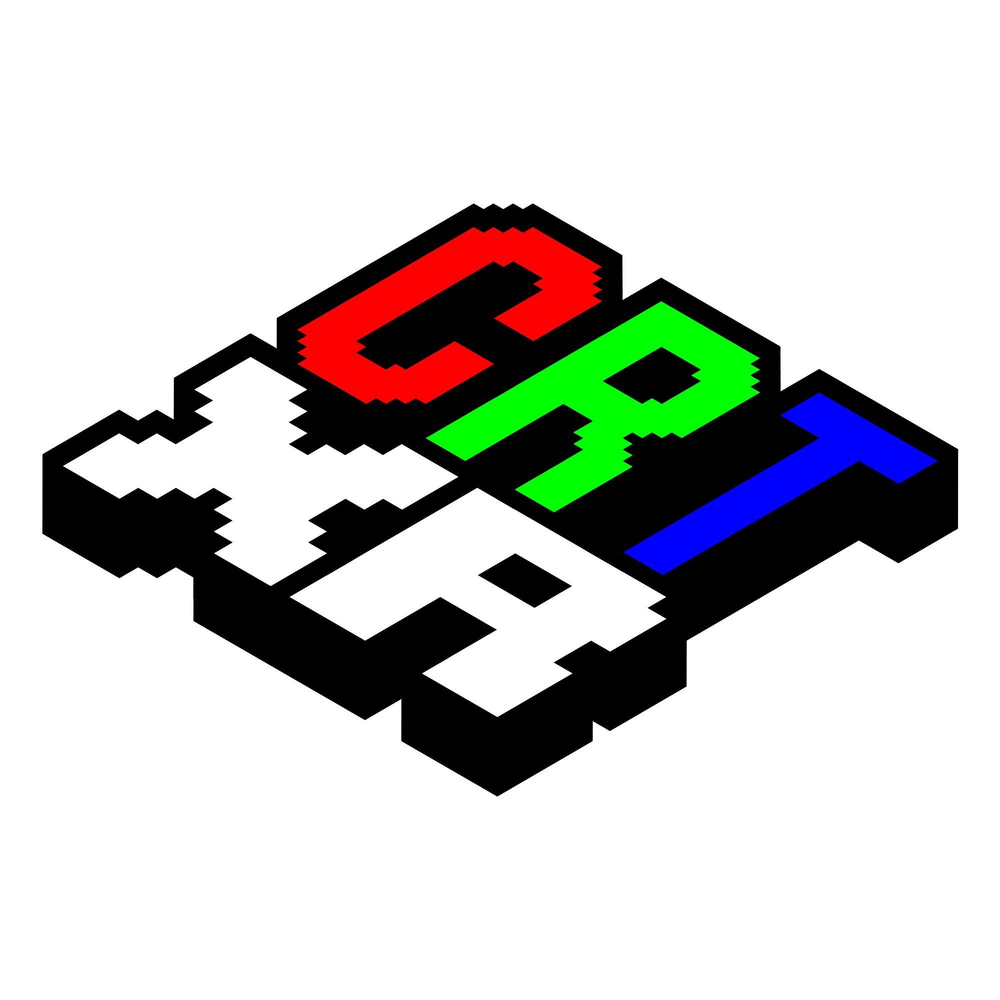
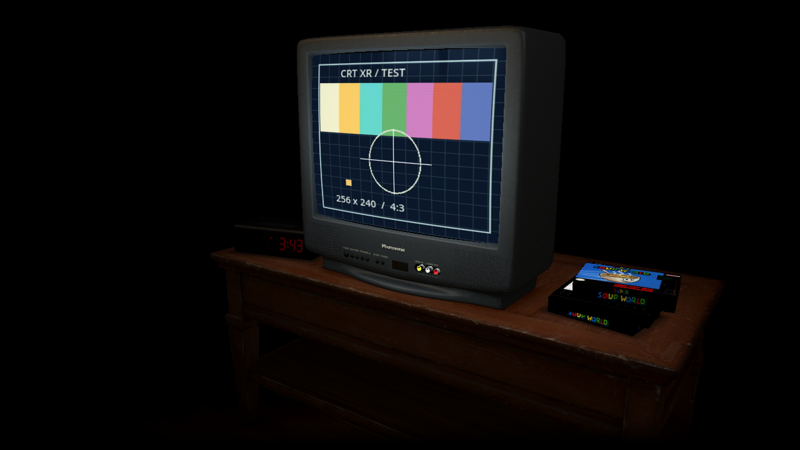

<p align="center">
  
</p>

<h1 align="center">CRT XR</h1>

<p align="center">
  A little CRT room for your XR glasses.<br>
  Retro games and your own videos, head tracking, warm lighting and the radio on in the background.
</p>

<p align="center">
  <a href="#features">Features</a> ·
  <a href="https://github.com/blackalice/CRT-XR/releases">Downloads</a> ·
  <a href="#install-on-steam-deck">Steam Deck setup</a> ·
  <a href="docs/GETTING-STARTED.md">Getting started</a> ·
  <a href="THIRD_PARTY.md">Credits</a>
</p>

> [!NOTE]
> CRT XR is an **early public beta**. VITURE Pro 2 has been tested on Steam Deck and Windows with an Xbox controller. Feedback and compatibility reports are welcome; see the [known limitations and remaining checks](docs/PRE-LAUNCH-CHECKLIST.md).



*An in-app capture of the room in the Dim XR mood, showing the built-in test signal. No game is included.*

## Features

- **A CRT in your space.** A detailed television, wooden table and baked contact shadows, with a dim red clock radio showing the real time, a VCR on a shelf and a stack of game boxes. Switch props off individually and choose 90s confetti carpet (the default), wool carpet or wooden floorboards. Light the room by the TV alone, add rain on the window or a ticking clock, and see the playing game's cover on the table. The surroundings fade into black to suit XR glasses.
- **Stereo and head tracking.** Full side-by-side rendering and rotational **3DoF** tracking let you look around an anchored screen. Adjust its distance, height, size and curvature, then recenter with a stick click.
- **A picture you can tune and keep.** Scanlines, phosphor detail, glass reflections, PAL/NTSC-inspired signal effects and colour controls. Trying a preset preserves your custom picture; restore it with **Custom**, or save up to three named picture presets. Screen-fitting options keep the full game image inside the tube.
- **Thirteen classic systems.** SNES, NES, Mega Drive / Genesis, Master System, Game Gear, Game Boy / Game Boy Color, Game Boy Advance, PC Engine / TurboGrafx-16, Sega CD / Mega-CD, Atari 2600, Atari Lynx, Neo Geo Pocket / Color and Vectrex, powered by libretro cores.
- **Your videos on the tube.** Choose a video folder and your MP4, M4V and MKV files play on the CRT with the same picture, light and sound as games: letterbox, 14:9 or fill for widescreen, subtitles, resume and Continue watching. The VCR joins in with green on-screen text, an optional VHS or worn-tape look and its mechanism sounds. The Steam Deck uses SteamOS's own FFmpeg; Windows downloads FFmpeg's video libraries once, on request.
- **A library that understands your folders.** Pick your ROM root or SD card and browse supported systems, Recent and Favourites. Unrelated console folders stay out of the way. If you've scraped box art with EmuDeck, ES-DE or RetroDECK, CRT XR shows it from your existing `downloaded_media` (or `media` folders beside your ROMs); nothing is downloaded.
- **Your music, in the room.** Play MP3 albums or direct MP3 web radio with positional sound and optional room reverb. Use the pause-menu transport and seek bar, and optionally lower game audio while music plays. The last track and position are restored, ready for you to press Play.
- **Responsive play.** Optional input preview in a separate copy of the emulator reduces input delay while keeping game audio intact. **Reset game** in the pause menu emulates the console's reset button and keeps battery saves and save states.
- **Controller-first adjustments.** Quick settings, organised settings pages, controller text entry, compact visual previews, per-option resets, saved setups and per-game picture preferences. Accessibility options include larger text, stronger contrast and reduced animation. Four save-state slots per game with pictures, automatic resume points and clean screenshots are built in. The menu header shows the time, and the Deck's battery.

Bring your own games and music. Cartridges can be plain files or sit alone in a ZIP (Deflate or stored; 7z and RAR are not read). Sega CD discs can be a `.cue` sheet, a `.bin` carrying the Sega CD header, or a CHD in a Sega CD folder (`segacd`, `megacd`, or a folder inside one). A zipped game shares its saves with the same game unzipped. Sega CD and Atari Lynx need their hardware's own files: the Sega CD BIOS (`bios_CD_U.bin` and friends) and the Lynx boot ROM (`lynxboot.img`). CRT XR finds them in the `bios` folder next to your `roms` folder (the EmuDeck layout), in `~/Applications/CRT-XR/bios` on the Deck, or in a `bios` folder next to `CRT-XR.exe` on Windows. The game library names anything still missing.

## Download the beta

**Beta.14 (0.1.0-beta.14)** is looking for **testers with XREAL, Rokid, RayNeo or other glasses**, and for first-time users: OpenTrack tracking on Windows, more glasses recognised on the Steam Deck, automatic side-by-side switching where the XR Gaming driver supports your glasses, and an in-app *Using glasses* guide. It adds a room lit by the TV alone, room sound, TV moments and your game's cover on the table. See the [beta.14 release notes](docs/RELEASE-NOTES-beta.14.md); beta.13 added [zipped games and Sega CD CHD discs](docs/RELEASE-NOTES-beta.13.md), beta.12 [box art, save slots and room presets](docs/RELEASE-NOTES-beta.12.md), and beta.10 [video playback with a VCR](docs/RELEASE-NOTES-beta.10.md).

Download from [GitHub Releases](https://github.com/blackalice/CRT-XR/releases). Pick **one** app package:

| You have | Download | Then |
|---|---|---|
| **Steam Deck** | `CRT-XR-0.1.0-beta.14-SteamDeck.tar.gz` | Extract it in Desktop Mode and double-click **Install CRT XR** |
| **Windows PC** | `CRT-XR-0.1.0-beta.14-Windows.zip` | Extract it and double-click **CRT-XR.exe** |

Each download opens with a short **HOW TO INSTALL** / **HOW TO START** file. The `…-source-code.tar.gz` file and GitHub's automatic "Source code" links are not apps: they are for rebuilding and licence compliance.

The app is free and early: please [report bugs](https://github.com/blackalice/CRT-XR/issues), suggest improvements and share compatibility results. This project has been built with substantial AI coding assistance (“vibe coded”); code reviews and contributions are welcome.

## What you need

| Platform | Current use |
|---|---|
| **Steam Deck + VITURE Pro 2** | The tested XR setup, including Gaming Mode mono-to-SBS startup. **Decky Loader and XR Gaming with Pro 2 support must already be installed**. Tracking compatibility is checked at runtime rather than restricted to one driver binary. |
| **Steam Deck without glasses** | Mono play. The latest automatic launcher includes this path; final hardware acceptance is still pending. |
| **Windows** | Portable app for normal-monitor play or SBS glasses. VITURE tracking has been tested locally on Pro 2 and needs the separately supplied VITURE Windows SDK; monitor play does not need it. Vendor SDK DLLs are not bundled. |

The intended setup is XR glasses with **SBS and 3DoF tracking exposed through a compatible XR Gaming driver**. We expect other compatible glasses to work, but **only VITURE Pro 2 has been tested**. On the Deck, tracking comes from XR Gaming, so glasses it supports should track; CRT XR recognises VITURE, XREAL, Rokid and RayNeo displays by name (only VITURE confirmed on hardware). Other models may need manual display/profile setup. SBS and built-in 3DoF alone do not guarantee that CRT XR can access tracking. See [display setup](docs/display-setup.md) and [Gaming Mode handoff notes](docs/SBS-HANDOFF-TEST.md).

## Install on Steam Deck

1. In **Desktop Mode**, download `CRT-XR-0.1.0-beta.14-SteamDeck.tar.gz` and extract it (right-click → Extract). Sign in to Steam at least once beforehand.
2. In the extracted folder, double-click **Install CRT XR**. Choose **Trust and Launch** if asked. Pick the VITURE Full SBS profile, or Deck / monitor only.
3. Let setup close Steam. It installs CRT XR, adds or updates its Steam shortcut and artwork, and keeps your settings, saves and custom artwork.
4. Restart Steam, then **Return to Gaming Mode → Library → Non-Steam → CRT XR**. You can delete the extracted folder.

For head tracking, **Decky Loader → XR Gaming** must already be installed and recognise your glasses (VITURE Pro 2 currently needs an XR Gaming release with Pro 2 support, which may be the testing channel). CRT XR does not install the plugin or replace your driver; without it you get a fixed view.

No SSH, Steam developer interface or administrator password is needed for CRT XR's app installer. The separately installed XR Gaming prerequisite has its own setup requirements. If the script opens as text, or you have several Steam accounts, follow the [full installation guide](docs/GETTING-STARTED.md).

### First launch with glasses

Leave XR Gaming’s **virtual display off** for CRT XR. Gaming Mode temporarily enables tracking-only output with compositor effects disabled, then restores the previous driver settings on exit. CRT XR supplies its own SBS rendering and head tracking.

Connect the glasses in **mono**, then launch CRT XR. Put them on and press their **SBS** button: nothing else to press. The view goes dark during the change and the room appears by itself. When you exit, switch them back to 2D and CRT XR closes. Glasses the XR Gaming driver can switch go into SBS and back by themselves.

The tested VITURE profile uses an explicit **3840 × 1080** Steam game resolution; **Native alone did not work on our test Deck**. Setup prepares that profile. If the view stays black, X retries; return the glasses to mono before using B / Escape to leave.

Open **Game library → Library locations** to choose your ROM folder or SD card. You can explore the built-in test signal before loading a game.

## Install on Windows

1. Extract `CRT-XR-0.1.0-beta.14-Windows.zip` to a folder (not inside the ZIP) and double-click **CRT-XR.exe**. It is portable and unsigned: if Windows warns, choose **More info → Run anyway**. Keep the files and folders next to the EXE together. For normal-monitor play, choose **Play on this screen without glasses**; the remaining steps are for glasses.
2. For glasses tracking, obtain the **VITURE Windows x86_64 SDK separately** and copy the contents of its `x86_64` folder into a folder named `sdk` beside the EXE. The beta does **not** include proprietary VITURE SDK DLLs; installing SpaceWalker alone does not configure this step. See [Windows setup](docs/WINDOWS-SETUP.md).
3. Close SpaceWalker so it does not compete for tracking. **Switch the glasses to SBS first**, then launch CRT XR on your normal monitor.
4. Choose the glasses display and select **Open glasses view**. The app moves under a black curtain and opens when the selected display is ready. For normal-monitor play, choose **Play on this screen without glasses**.

Windows uses native Xbox-compatible controller support. **LB + RB + Start** opens the menu (L1 + R1 + Start on the Deck); **R3** recentres. Both platforms use the same TV-distance range; desktop and XR field-of-view calibration are stored separately. Mixed Windows display scaling is handled by the exported app's per-monitor DPI manifest.

Only **VITURE Pro 2** has been tested for Windows tracking. **Other glasses** can track through **OpenTrack**: run a tool that sends OpenTrack UDP to `127.0.0.1` port `4242` (for example [opentrack](https://github.com/opentrack/opentrack), [PhoenixHeadTracker](https://github.com/iVideoGameBoss/PhoenixHeadTracker) for XREAL Air, or VertoXR for Rokid and RayNeo), then choose **Controls & XR → Tracking → Tracking source → OpenTrack**. This path is untested with real non-VITURE glasses; if a direction is reversed, invert that axis on the same page. SBS works with any glasses that offer a full side-by-side mode. Public-package setup with a different Windows user and extended reconnect/suspend testing remain beta feedback areas.

## ROM folders

In **Game library → Library locations**, select your **main ROM folder**—the folder containing the console folders. An existing EmuDeck-style layout can stay where it is, including on an SD card:

```text
roms/
├── snes/
│   ├── Game.sfc
│   └── RPGs/
│       └── Another game.smc
├── nes/
│   └── Game.nes
├── megadrive/       # genesis/ also works
│   └── Game.md
├── mastersystem/
│   └── Game.sms
├── gamegear/
│   └── Game.gg
├── gb/              # gbc/ and gameboy/ also work
│   └── Game.gb
├── gba/
│   └── Game.gba
├── pcengine/        # tg16/ turbografx16/ also work
│   └── Game.pce
├── segacd/          # megacd/ also works; needs the BIOS files
│   ├── Game.cue
│   └── Game.bin
├── atari2600/       # atari/ atarivcs/ also work
│   └── Game.a26
├── atarilynx/       # needs lynxboot.img
│   └── Game.lynx
├── ngpc/            # ngp/ neogeopocket/ also work
│   └── Game.ngpc
└── vectrex/
    └── Game.vec
```

Windows users can open **Computer drives** directly in the browser, including mapped drives, or use **Open folder or network path…** with a path such as `\\server\share\roms`. Connect protected shares in Windows File Explorer first. Choose **Use this folder for my library** to save the root.

CRT XR discovers supported games in subfolders and presents them by system; you do not need to move ROMs into the app folder. Common folder aliases such as `genesis`, `superfamicom`, `sms` and `gg` are recognised. Folder names help discovery, while the supported file type/content chooses the emulator core. You can also select a single supported system folder or browse to a game directly.

Known unsupported system folders and artwork/BIOS/save folders are skipped when scanning the main library, so a larger multi-system collection is fine. Supported, recognised games appear, including zipped cartridges and Sega CD CHDs. No ROMs are supplied.

PC Engine, Atari 2600, Lynx and Vectrex still need real-game testing beyond diagnostic programs. PC Engine CD, SuperGrafx, Sega 32X, 7z/RAR archives and discs inside ZIPs are unsupported. Sega CD needs the BIOS matching the disc's region; a different region's BIOS can produce a generic load error. See [supported formats and BIOS setup](docs/emulation.md).

## Videos

In **Game library → Library locations**, select **Choose a video folder** and pick the folder holding your videos; subfolders are included. A **Videos** card then appears after your consoles. MP4, M4V and MKV files are listed, with any `.srt` subtitles beside them.

- **Steam Deck:** nothing to install; SteamOS's FFmpeg is used and decoding runs on the GPU.
- **Windows:** choose **Set up video playback** in Library locations. CRT XR downloads FFmpeg's five LGPL video libraries (about 55 MB) from the public [BtbN builds](https://github.com/BtbN/FFmpeg-Builds), checks them and keeps them in its own user-data folder.
- **Other Linux systems:** install FFmpeg 7.1 or 8 with your package manager.

While watching, **A** pauses, **D-pad left/right** skips 10 seconds (hold to scrub), **up/down** skips a minute, **Y** changes the picture shape and **X** the audio track; the menu has a scrubbable timeline. Settings are in the **Videos** category: **Picture** (the video picture, shape, lines, interlacing), **VCR** (tape look, on-screen text, sounds) and **Playback** (subtitles, hardware decoding, folder). See [Videos](docs/emulation.md#videos) for details.

## Controls

On Steam Deck, use Steam's **Gamepad With Joystick Trackpad** layout. On Windows, use an Xbox/XInput-compatible controller directly. You do not need to hold the three-lines button to switch Desktop/gamepad mappings.

| Action | Controller | Keyboard |
|---|---|---|
| Open / close menu | L1 + R1 + Start | Escape |
| Recenter | R3 | R |
| Select / adjust a setting | Up/down / left/right | Arrow keys |
| Activate / go back | A / B | Enter / Backspace |
| Change category / subsection | L1/R1 / L2/R2 | Q/E / Z/C |
| Reset selected option | Y | Y |
| Compact adjustment preview | X | X |
| Move TV closer / farther | Right stick, when enabled | Page Up / Page Down |
| Screenshot | Pause menu | F6 |

Continue or library setup leads the home screen. Quick settings opens TV placement, recenter, picture presets and both volume controls. In game lists, left/right jumps ten games and scrolls the selection into view. **Reset game** is in the pause menu. **Controls & XR → Separate preview core** controls the separate emulator copy used by **Reduce input delay**. Save picture presets under **Picture → Presets**; accessibility options are under **About & Help → Accessibility**. In side-by-side 3D the menu floats in front of the TV, the selected item lifts towards you and the room dims behind it (never in the compact preview); **Menu depth** turns this off, **Curved menu** bends it gently towards you, and **Controller vibration** adds a light tick as you move. Music uses a compact strip when idle or paused and expands its transport and timeline during playback. Left/right selects playback controls or seeks; up/down moves between music and game actions. Game controls follow each supported console's layout.

## Updates, help and feedback

On Steam Deck, run the installer from a newer complete package to update the existing Steam entry. On Windows, extract a new complete folder and run it; settings and saves remain in the separate user-data folder. Previous program versions are retained, and settings/saves live separately from the application. Old **RetroCRT XR** data is copied on first launch without deleting the originals.

- [Getting started and recovery](docs/GETTING-STARTED.md)
- [Picture controls](docs/picture-controls.md) · [Room and view](docs/room-and-view.md) · [Audio](docs/audio.md)
- [Development and builds](docs/DEVELOPMENT.md)
- [Pre-launch checklist](docs/PRE-LAUNCH-CHECKLIST.md) · [Detailed beta review](docs/BETA-REVIEW.md)

For a bug report, use **About & Help → Copy diagnostics** and include your device, Desktop/Gaming Mode, mono/SBS, and steps to reproduce. Review logs before sharing: they can contain local paths or radio URLs.

## Credits and licensing

Built with **Godot** and **libretro**, with credited third-party models, shaders and audio components. See [THIRD_PARTY.md](THIRD_PARTY.md) for authors, licences and modifications.

Original CRT XR code and documentation use the [MIT License](LICENSE). See [licensing scope and exclusions](LICENSING.md). Bundled emulator cores and assets retain their own terms; the complete package must not be described as wholly permissive. The [core distribution review](docs/CORE-DISTRIBUTION.md) explains the in-process GPL treatment, exact source builds and corresponding-source materials; retain that source download alongside executable releases.
