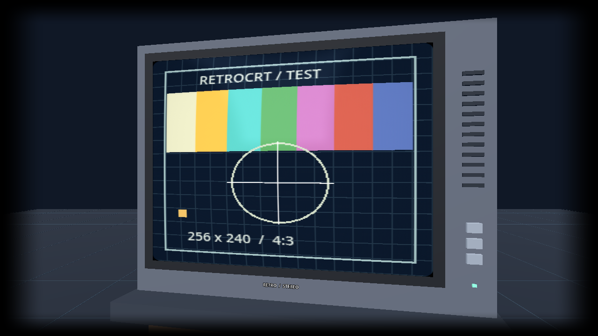
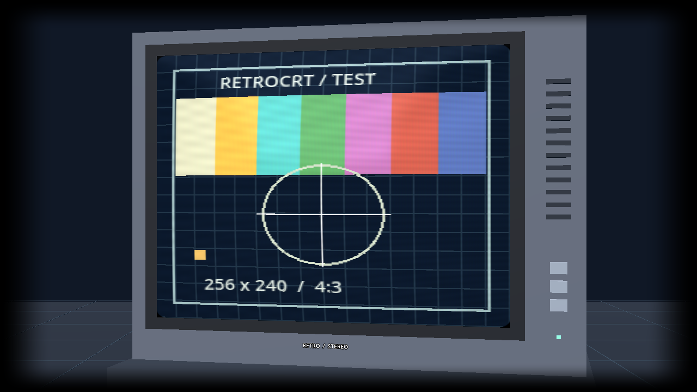

# CRT rendering direction

Research and local prototype: 14 October 2026, Godot 4.5.1 Compatibility renderer.

## Scene lighting and distance fade

The room now has a black background, low cool ambient light, a warm overhead
spotlight with shadows and a weaker cool fill. Both local lights follow the TV
when its distance changes. The picture remains self-lit and the existing glass
effect remains separate.

Surrounding geometry fades smoothly between 4.5 and 11 metres from each eye.
The cabinet and support use a shared black material overlay, preserving their
original PBR maps. The floor uses the same distance curve directly in its shader;
its subtle, antialiased grid replaces the previous individual grid meshes.
The game picture and glass are excluded from the room fade for readability.
This implementation uses ordinary Compatibility shaders, without volumetric fog
or a full-screen depth effect. Cabinet overlays add a draw pass, and only the
key light casts shadows; Steam Deck performance remains to be measured.

Validation: run `tests/room_lighting.gd` with graphics enabled for pixel checks
of the near/far floor and an opaque PBR object. Both checks passed locally,
along with all 17 scene/stereo checks in `tests/smoke.gd`. The lighting tests use
simple geometry, independently of the third-party cabinet.

## Recommendation

Use a real curved mesh for the tube, an RGB picture shader on its phosphor
surface, and a separate curved glass faceplate. The mesh supplies consistent
depth and curvature to both cameras. Apply the picture effects in tube UVs,
never to the combined SBS image or the room. Keep the existing soft viewport
edges as an independent comfort effect.

Aim for a clean consumer RGB CRT first: a little beam softness, restrained
scanlines, an aperture grille, bright-area glow and subtle glass reflections.
Strong colour bleed, flicker, noise and persistence would need separate options
and visual testing; they should not define the default appearance.

## Approaches considered

| Approach | Fit for this app |
| --- | --- |
| Flat scanline overlay | Cheap, but supplies neither tube depth nor glass, and can shimmer as the TV changes apparent size. |
| Lightweight tube shader plus curved geometry | Recommended starting point. Integrates directly with both Godot cameras and leaves control over sampling and reflections. |
| CRT-Royale / advanced Guest presets | Useful visual references and possible future quality modes. Their complete multipass pipelines need deliberate Godot integration and measurements on the Deck. |
| Screen-space refractive glass | Can distort the rendered scene, but brings sorting and off-screen limitations. Unnecessary for the initial faceplate. |
| Environment reflection on a separate faceplate | Recommended. The prototype uses a small procedural lighting environment; a furnished room could use a reflection probe or authored cubemap. |

Libretro describes CRT shaders in terms of scanlines, masks, blending, glow and
curvature. Its shader guide also discusses the resolution dependence of repeating
patterns and the extra demands of Royale. These are references for the choice of
effects, not code imported into this project:
[Libretro CRT shader guide](https://docs.libretro.com/shader/crt/).

Godot's material documentation explains the limitations of screen-space
refraction, including transparency sorting and unavailable off-screen objects:
[StandardMaterial3D: refraction](https://docs.godotengine.org/en/4.5/tutorials/3d/standard_material_3d.html#refraction).
Screen-space reflections require Forward+, whereas this application deliberately
uses Compatibility. Godot 4.5 does have a separate Compatibility glow
implementation; a renderer change is not required to experiment with glow:
[Environment and post-processing](https://docs.godotengine.org/en/4.5/tutorials/3d/environment_and_post_processing.html).

## Implemented locally

- Existing convex tube geometry retained; analytic surface normals added to
  remove faceting from reflections. No additional barrel distortion in the shader.
- Original five-sample picture shader: linear texture filtering, approximate
  gamma-aware effect arithmetic, source-row beam modulation, smooth RGB grille,
  local bright-area spread, mild edge falloff and rounded picture corners.
- Derivatives reduce scanline/grille contrast as their projected frequency
  approaches the eye viewport's sampling limit. This mitigates pattern moire;
  it is not a complete anisotropic reconstruction filter.
- Scanline mean compensation reduces loss of overall brightness. Bright areas
  have slightly broader beams. Glow is a local approximation, not a full
  multipass optical scatter simulation.
- Separate faceplate 6 mm ahead of the picture, with smooth normals and a
  Fresnel-weighted additive reflection. The depth is an artistic starting value.
- Procedural cool room-light shapes are evaluated from each camera position
  and world-space surface normals. They are shared world directions, not a
  reflection of the current floor, TV or actual room geometry. There is no
  ray tracing, screen-space refraction or transmission simulation in this version.
- Glass reflections and phosphor glow sliders, both defaulting to 0.12, saved
  alongside existing scanline and mask settings. Glass can be disabled entirely.
- Compatibility colour-space handling uses Godot's `OUTPUT_IS_SRGB` flag:
  [Spatial shader built-ins](https://docs.godotengine.org/en/4.5/tutorials/shaders/shader_reference/spatial_shader.html#global-built-ins).

The reflection is intentionally weak over dark game content. Additive glass is
an inexpensive visual approximation rather than an energy-conserving dielectric.
A cubemap/probe and better transmission can be considered after the surrounding
room and Deck performance budget are established.

The first preview uses a closer, angled TV for inspection. The latest default
viewing distance is 3.4 m, as requested by the user after the Deck test.

### Adjustable physical curvature

The latest local build adds **Screen curvature (0 = flat)** to settings, persisted
as `crt/curvature`. The default is 0.55: 66 mm centre bulge across the 1.32 m
unscaled tube width. The range is flat through 120 mm. The phosphor and glass
share a regenerated mesh and analytic normals, retaining the 6 mm faceplate
offset at every setting. The shader does not add a second barrel warp.

This inspection preview uses a 24-degree vertical FOV and angles the TV slightly
to make the physical bulge visible. Normal startup keeps the TV facing forward.

## Validation and next hardware check

Windows NVIDIA OpenGL Compatibility: both shaders compiled and rendered without
errors. Mono and SBS captures were inspected. A frozen test signal comparison
with glass off/on changed 113,668 pixels, with a maximum red-channel contribution
of 0.0432 at the default reflection setting. This verifies visible restrained
contribution, not physical optical accuracy. All 13 scene smoke checks and all
17 GPU emulator application checks passed after the change.

The earlier glass/shader build ran on the Deck with Mario, and the user reported
that it looked amazing. The later curvature slider and 3.4 m default are local
only because the Deck was then switched off. No sustained Deck frame-time or
battery-performance claims are made.

When available, test at actual 3840x1080 SBS output: small text and scrolling,
dark scenes under glass reflections, scanline stability while turning the head,
and frame times with emulation running. Compare glass and glow at zero, default
and maximum. Prefer reducing grille strength if patterns shimmer; budget a
shared bloom prepass only if the local glow approximation proves insufficient.
